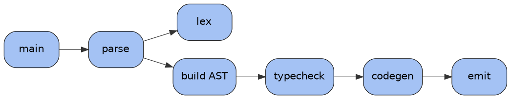
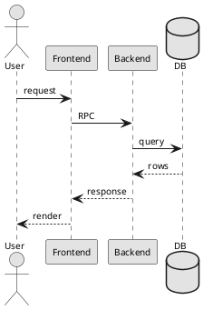

# Architecture Diagram Design Guide for Top CS Conferences

A reference document distilling figure-design conventions used at A\*/A-ranked CS venues (NeurIPS, ICML, ICLR, CVPR, ICCV, ECCV, ACL, EMNLP, SIGGRAPH, OSDI, SOSP, ASPLOS, ISCA, MICRO, PLDI, POPL, OOPSLA, ICSE, FSE, SIGMOD, VLDB, SIGCOMM, NSDI, USENIX Security, CCS, CHI, STOC, FOCS, ICRA, IROS, CoRL, RSS). The target audience is an AI agent producing diagrams indistinguishable from those in top-quartile published work. Every section is meant to be actionable, with concrete numbers, hex codes, and code where possible.

---

## Table of Contents

1. [Core Philosophy](#1-core-philosophy)
2. [Tooling Overview](#2-tooling-overview)
3. [TikZ Deep Dive](#3-tikz-deep-dive)
4. [Matplotlib for Publication Plots](#4-matplotlib-for-publication-plots)
5. [Inkscape & SVG Workflows](#5-inkscape--svg-workflows)
6. [Other Tools (Asymptote, Graphviz, Mermaid, PlantUML, D2)](#6-other-tools)
7. [Color Palettes](#7-color-palettes)
8. [Typography](#8-typography)
9. [Layout Principles](#9-layout-principles)
10. [Building Blocks](#10-building-blocks)
11. [Composition Patterns](#11-composition-patterns)
12. [The Headline Figure (Figure 1)](#12-the-headline-figure-figure-1)
13. [Domain-Specific Conventions](#13-domain-specific-conventions)
14. [Quality Checklist](#14-quality-checklist)
15. [Anti-Patterns](#15-anti-patterns)
16. [Landmark Figures Worth Studying](#16-landmark-figures-worth-studying)
17. [TikZ Cookbook (Copy-Paste Templates)](#17-tikz-cookbook)
18. [AI Agent Operating Instructions](#18-ai-agent-operating-instructions)

---

## 1. Core Philosophy

Reviewers spend ~30 seconds on Figure 1 before deciding whether to keep reading. Good architecture diagrams in top venues share four properties:

1. **One idea per figure.** The headline figure communicates a single contribution. If a legend has more than three rows or the caption needs a paragraph to disambiguate, the figure is doing too much.
2. **Read left-to-right or top-to-bottom in a single sweep.** Information flow must be unambiguous without arrows being chased back and forth. No crossing arrows unless mathematically necessary.
3. **Semantic visual encoding.** Every color, line style, shape, and icon means something consistent. Decoration without semantic load is removed.
4. **Vector everything.** PDF or SVG. Raster (PNG/JPG) only when the diagram embeds real photographs or rendered images — and even then, wrapped inside a vector container.

**Heuristics:**
- Figure 1 should be understandable to a non-expert in the subfield in ~15 seconds.
- The main architecture figure should be understandable to someone in the subfield in under a minute without reading the caption.
- A caption that says "Our method." has failed. A caption that says "Our method maps $X$ to $Y$ via $Z$; pink modules are trained, gray are frozen." has succeeded.

---

## 2. Tooling Overview

| Tool | Output | Best for | Trade-offs |
|------|--------|----------|------------|
| **TikZ / PGF** | PDF (vector) | LaTeX-native diagrams, exact positioning, perfect font match | Steep learning curve; slow iteration |
| **Matplotlib + PGF backend** | PDF (vector) | Plots, charts, procedurally generated figures | Architecture diagrams via patches are tedious |
| **Inkscape** | SVG → PDF | Manual layout, editing existing SVGs, free | Easy to produce non-vector outputs; needs care |
| **Adobe Illustrator** | SVG/PDF | Industry-standard polish | Paid; overkill for simple diagrams |
| **Asymptote** | PDF/EPS | Mathematical figures with 3D, plotting | Niche; rendering 3D scenes is its strength |
| **Graphviz / dot** | PDF/SVG | Auto-layout for graphs, call graphs, trees | Default styling looks generic — must customize |
| **PlantUML** | PNG/SVG | UML class/sequence/state/deployment diagrams | Software-engineering specific |
| **Mermaid** | SVG | Quick flowcharts and sequence diagrams in Markdown | Limited styling control |
| **D2** | SVG/PDF | Modern declarative diagrams with clean defaults | Newer, smaller ecosystem |
| **draw.io / diagrams.net** | SVG/PDF | Quick block diagrams, free | Default styles look generic |
| **Figma** | SVG | Collaborative iteration, modern UI | Not LaTeX-aware; manual font matching |
| **OmniGraffle** | PDF/SVG | Polished outputs, native macOS | Paid; macOS-only |
| **PowerPoint / Keynote** | PDF | Fast iteration; common at top venues | Easy to produce amateur-looking output |
| **Excalidraw** | SVG | Sketchy, conceptual diagrams | Distinct aesthetic; wrong for formal architecture |

### 2.1 Recommended Defaults for an AI Agent

| Figure type | Primary tool | Fallback |
|-------------|-------------|----------|
| Pipeline / architecture block diagram | **TikZ** | SVG via Inkscape |
| Plots (line, bar, scatter) | **Matplotlib + PGF** | TikZ/pgfplots |
| Graphs / trees with many nodes | **Graphviz** (dot/neato), styled | TikZ with `graphdrawing` library |
| UML / sequence diagrams | **TikZ-UML** or **PlantUML** | Mermaid |
| 3D mathematical figures | **Asymptote** | TikZ with `3d` library |
| State machines / automata | **TikZ** with `automata` library | Graphviz |
| Quick exploratory sketch (non-publication) | Excalidraw or Mermaid | Whiteboard |

### 2.2 Universal Rules

1. **Output must be vector PDF** for inclusion via `\includegraphics`.
2. **Text inside the figure must be selectable** in the final PDF (real text, not outlined paths).
3. **Font in the figure must match the paper.** Use `\usepackage{tikz}` so TikZ inherits LaTeX's fonts directly, or configure matplotlib's `pgf` backend with the paper's preamble.
4. **No embedded raster** unless the content is a real photograph or rendered image.
5. **Reproducibility:** source files (`.tex`, `.py`, `.svg`) live alongside the paper and regenerate the PDF deterministically.

---

## 3. TikZ Deep Dive

TikZ is the default for in-paper architecture diagrams because it inherits the paper's font automatically, produces small vector PDFs, and lives in the same `.tex` file as the rest of the paper.

### 3.1 Minimal Preamble

```latex
\documentclass{article}
\usepackage{tikz}
\usetikzlibrary{
  arrows.meta,        % modern arrow tips (Stealth, Latex, etc.)
  positioning,        % "right=of foo", "below=2mm of foo"
  calc,               % coordinate arithmetic ($A+(0,1)$)
  fit,                % background panels that fit a set of nodes
  backgrounds,        % named layers for backgrounds
  shapes.geometric,   % cylinder, trapezium, regular polygons
  shapes.symbols,     % cloud, tape
  decorations.pathreplacing, % braces, snake decorations
  decorations.markings,      % arrowheads mid-path
  shadows.blur,       % subtle shadows (use sparingly)
  patterns,           % hatching fills
  matrix,             % grid layouts
  chains,             % linear pipelines
  automata,           % state-machine diagrams
  trees,              % tree layouts
}
\usepackage{pgfplots}                % for plots
\pgfplotsset{compat=1.18}
\usepackage{xcolor}                  % named colors
```

### 3.2 Define Your Palette Once

```latex
% Pick ONE palette per paper and define semantic names.
\definecolor{cBlue}   {HTML}{4E79A7}
\definecolor{cOrange} {HTML}{F28E2B}
\definecolor{cRed}    {HTML}{E15759}
\definecolor{cTeal}   {HTML}{76B7B2}
\definecolor{cGreen}  {HTML}{59A14F}
\definecolor{cYellow} {HTML}{EDC948}
\definecolor{cPurple} {HTML}{B07AA1}
\definecolor{cPink}   {HTML}{FF9DA7}
\definecolor{cBrown}  {HTML}{9C755F}
\definecolor{cGray}   {HTML}{BAB0AC}

% Semantic aliases — refer to these in figures, not raw palette names.
\colorlet{cInput}     {cBlue!20}
\colorlet{cInputEdge} {cBlue!70!black}
\colorlet{cModule}    {cOrange!25}
\colorlet{cModuleEdge}{cOrange!70!black}
\colorlet{cOutput}    {cGreen!25}
\colorlet{cOutputEdge}{cGreen!70!black}
\colorlet{cFrozen}    {black!8}
\colorlet{cFrozenEdge}{black!50}
\colorlet{cAccent}    {cRed}
\colorlet{cTextDark}  {black!85}
```

### 3.3 Define Reusable Styles

```latex
\tikzset{
  % Base node — never use raw "rectangle" in a diagram; always a named style.
  block/.style={
    rectangle, rounded corners=2pt,
    draw=cTextDark, line width=0.6pt,
    minimum width=22mm, minimum height=8mm,
    align=center, font=\small,
    inner sep=3pt,
  },
  input/.style    ={block, fill=cInput,  draw=cInputEdge},
  module/.style   ={block, fill=cModule, draw=cModuleEdge},
  output/.style   ={block, fill=cOutput, draw=cOutputEdge},
  frozen/.style   ={block, fill=cFrozen, draw=cFrozenEdge, text=black!70},
  emph/.style     ={block, fill=cAccent!25, draw=cAccent, line width=1pt},
  % Data tensors as sharp rectangles
  tensor/.style={
    rectangle, draw=cTextDark, line width=0.4pt,
    minimum width=10mm, minimum height=6mm,
    font=\scriptsize\ttfamily, fill=white,
  },
  % Operator nodes (sum, concat)
  op/.style={
    circle, draw=cTextDark, line width=0.6pt,
    inner sep=0pt, minimum size=4mm, font=\small,
  },
  % Arrow styles
  flow/.style={
    -{Stealth[length=2mm, width=1.6mm]},
    line width=0.7pt, draw=cTextDark,
  },
  gradflow/.style={
    flow, dashed, draw=cAccent,
  },
  skip/.style={
    flow, line width=0.6pt, draw=cTextDark!70,
  },
  % Annotation labels on edges
  shape/.style={
    midway, above, font=\scriptsize\ttfamily, sloped=false,
    fill=white, inner sep=1pt,
  },
}
```

### 3.4 Anatomy of a Block Diagram

```latex
\begin{tikzpicture}[node distance=8mm and 12mm]
  % Nodes
  \node[input]                       (img)   {Input};
  \node[module, right=of img]        (enc)   {Encoder};
  \node[module, right=of enc]        (proj)  {Projector};
  \node[emph,   right=of proj]       (core)  {\textbf{Our Module}};
  \node[output, right=of core]       (out)   {Output};

  % Edges with annotations
  \draw[flow] (img)  -- node[shape] {[B,3,H,W]} (enc);
  \draw[flow] (enc)  -- node[shape] {[B,N,D]}   (proj);
  \draw[flow] (proj) -- node[shape] {[B,N,D']}  (core);
  \draw[flow] (core) -- node[shape] {[B,K]}     (out);
\end{tikzpicture}
```

### 3.5 Background Panels (Grouping)

```latex
\begin{tikzpicture}[node distance=8mm]
  \node[module] (a) {A};
  \node[module, right=of a] (b) {B};
  \node[module, right=of b] (c) {C};
  \begin{scope}[on background layer]
    \node[draw=black!30, dashed, rounded corners=2pt,
          fill=black!4, inner sep=4pt,
          fit=(a)(b)(c), label=above:{\small Encoder stack}] {};
  \end{scope}
\end{tikzpicture}
```

`on background layer` places the panel behind the nodes; `fit=` grows the panel to enclose them; `label=above:` adds a title outside the panel.

### 3.6 Skip Connections

```latex
\draw[skip] (a.north) to[out=90,in=90,looseness=1.5] (c.north);
```

`to[out=angle,in=angle]` creates a smooth Bezier curve. `looseness` (default 1) controls how far the curve extends; 1.5–2 is typical for skip connections arcing over a sequence of blocks.

### 3.7 Repeated Block Notation ("×N")

```latex
\node[module] (b1) {Layer};
\node[module, right=2mm of b1, fill=cModule!60] (b2) {Layer};
\node[module, right=2mm of b2, fill=cModule!40] (b3) {Layer};
\node[right=2mm of b3, font=\small] {$\times N$};
```

Three layered fills with decreasing opacity create the "stack" visual that signals repetition.

### 3.8 Operator Nodes

```latex
\node[op] (sum) {$+$};       % element-wise sum
\node[op] (mul) {$\times$};  % multiplication
\node[op] (cat) {$\frown$};  % concatenation (also $\Vert$ or "concat")
\node[op] (had) {$\odot$};   % Hadamard product
```

### 3.9 Frozen vs Trainable Icons

```latex
\usepackage{fontawesome5}

\node[frozen] {Pretrained \faSnowflake};
\node[emph]   {Adapter \faFire};
```

If `fontawesome5` is unavailable, use Unicode (❄, 🔥) under XeLaTeX/LuaLaTeX, or draw simple icons with TikZ paths.

### 3.10 pgfplots for Inline Charts

```latex
\begin{tikzpicture}
  \begin{axis}[
    width=7cm, height=5cm,
    xlabel={Training steps ($\times 10^3$)},
    ylabel={Accuracy (\%)},
    xmin=0, xmax=100, ymin=50, ymax=100,
    grid=major, grid style={black!10},
    legend pos=south east,
    legend cell align=left,
    legend style={font=\footnotesize, draw=none, fill=white, fill opacity=0.8},
    tick label style={font=\footnotesize},
    label style={font=\footnotesize},
    axis line style={black!60},
  ]
    \addplot[color=cBlue,   line width=1pt, mark=none]
      coordinates {(0,52)(20,71)(40,82)(60,87)(80,90)(100,91)};
    \addplot[color=cOrange, line width=1pt, mark=none]
      coordinates {(0,52)(20,65)(40,75)(60,81)(80,84)(100,85)};
    \legend{Ours, Baseline}
  \end{axis}
\end{tikzpicture}
```

### 3.11 Sizing Conventions

- Match the figure width to the column or page width. Design at final size and avoid `\resizebox`.
- Default `node distance` between blocks: `8 mm` vertical, `12 mm` horizontal.
- Default `minimum width` for module blocks: `22–28 mm`. Modules should look uniform unless one is deliberately emphasized.

### 3.12 Standalone Figures (One File per Figure)

For each figure in its own file:

```latex
% file: figs/architecture.tex
\documentclass[crop, tikz, border=2pt]{standalone}
\usepackage{tikz}
\usetikzlibrary{arrows.meta, positioning, calc, fit, backgrounds}
% ... (preamble as above)
\begin{document}
\begin{tikzpicture}
  % ... figure ...
\end{tikzpicture}
\end{document}
```

Compile with `pdflatex architecture.tex` → produces `architecture.pdf` cropped to the figure. Include with `\includegraphics{figs/architecture.pdf}`. Benefits: parallel compilation, faster iteration, reusable across papers.

### 3.13 Common TikZ Gotchas

| Symptom | Cause | Fix |
|---------|-------|-----|
| Arrows overlap with node borders | Drawn to node center | Use `node.east`/`node.west` anchors or `arrows.meta` tips |
| Text crashes into nodes | `inner sep` too small | Increase `inner sep=4pt` |
| Crossing arrows hard to read | Two arrows at same coordinate | Add `to[bend left=15]` or route via an invisible waypoint |
| Figure too small in final PDF | Designed at wrong scale | Design at final intended size |
| Font mismatch with paper | Standalone uses default LaTeX font | Match the paper's `\usepackage{...}` in the standalone preamble |
| Crisp on screen, blurry in print | Raster image embedded | Use pure TikZ or vector PDF/EPS |

---

## 4. Matplotlib for Publication Plots

Matplotlib is the dominant tool for charts (line, bar, scatter, heatmap). The defaults are not publication-quality; the configuration below produces output that matches top venues.

### 4.1 Recommended rcParams

```python
import matplotlib.pyplot as plt
import matplotlib as mpl

mpl.rcParams.update({
    # Backend / output
    "pgf.texsystem": "pdflatex",
    "text.usetex": True,                # render text via LaTeX
    "font.family": "serif",
    "font.serif": [],                   # let LaTeX choose
    "font.size": 9,                     # body size at final figure scale
    "axes.titlesize": 9,
    "axes.labelsize": 9,
    "xtick.labelsize": 8,
    "ytick.labelsize": 8,
    "legend.fontsize": 8,
    "figure.titlesize": 10,

    # Lines & markers
    "lines.linewidth": 1.2,
    "lines.markersize": 4,
    "patch.linewidth": 0.6,

    # Axes
    "axes.linewidth": 0.6,
    "axes.edgecolor": "#333333",
    "axes.labelcolor": "#333333",
    "axes.spines.top": False,
    "axes.spines.right": False,
    "axes.grid": True,
    "grid.color": "#DDDDDD",
    "grid.linewidth": 0.4,
    "grid.alpha": 0.7,

    # Ticks
    "xtick.color": "#333333",
    "ytick.color": "#333333",
    "xtick.major.width": 0.6,
    "ytick.major.width": 0.6,
    "xtick.direction": "out",
    "ytick.direction": "out",

    # Legend
    "legend.frameon": False,
    "legend.handlelength": 1.5,

    # Figure / saving
    "figure.dpi": 150,                  # for screen preview
    "savefig.dpi": 300,                 # for raster fallback
    "savefig.bbox": "tight",
    "savefig.pad_inches": 0.02,
    "pdf.fonttype": 42,                 # TrueType, so text stays selectable
    "ps.fonttype": 42,
})
```

### 4.2 Figure Sizing

Compute figure size in inches from the paper column width:

```python
# IEEE / ACM two-column: column width ~3.33in, text width ~7.16in
# NeurIPS single-column: text width ~5.5in
COL_WIDTH  = 3.33
TEXT_WIDTH = 7.16

fig, ax = plt.subplots(figsize=(COL_WIDTH, COL_WIDTH * 0.75))
# ... plot ...
fig.savefig("plot.pdf")
```

**Golden rule:** design at the final size; do not let LaTeX scale the figure. `\includegraphics[width=\columnwidth]{plot.pdf}` should be a no-op (1:1 scaling).

### 4.3 Color Cycle

```python
from cycler import cycler

palette = ["#4E79A7", "#F28E2B", "#E15759", "#76B7B2",
           "#59A14F", "#EDC948", "#B07AA1", "#FF9DA7"]
mpl.rcParams["axes.prop_cycle"] = cycler(color=palette)
```

### 4.4 PGF Output (Perfect Font Match)

For figures that must use the paper's exact LaTeX font and math:

```python
mpl.use("pgf")
mpl.rcParams.update({
    "pgf.texsystem": "pdflatex",
    "pgf.rcfonts": False,
    "pgf.preamble": r"""
        \usepackage[utf8]{inputenc}
        \usepackage[T1]{fontenc}
        \usepackage{newtxtext,newtxmath}
    """,
})
fig.savefig("plot.pgf")          # include with \input{plot.pgf} in LaTeX
fig.savefig("plot.pdf")          # or include as PDF
```

### 4.5 Confidence Intervals

```python
import numpy as np
ax.plot(x, mean, color="#4E79A7", label="Ours")
ax.fill_between(x, mean - std, mean + std,
                color="#4E79A7", alpha=0.2, linewidth=0)
```

Solid line for the mean, translucent fill for the band. Do not combine error bars with shaded regions on the same series.

### 4.6 Bar Charts

```python
positions = np.arange(len(methods))
ax.bar(positions, values, width=0.6,
       color=palette[:len(methods)],
       edgecolor="#333333", linewidth=0.5)
ax.set_xticks(positions)
ax.set_xticklabels(methods, rotation=0)
```

For grouped bars, offset by `width` per group. Never use 3D bar charts.

### 4.7 Heatmaps

```python
im = ax.imshow(matrix, cmap="viridis", aspect="auto",
               interpolation="nearest")
fig.colorbar(im, ax=ax, shrink=0.8, pad=0.02, label="Activation")
```

- Continuous data: `viridis`, `magma`, `cividis`. **Never** `jet` or `rainbow` — both are scientifically discredited and color-blind unsafe.
- Diverging data (centered on zero): `RdBu_r` or `coolwarm`.
- Qualitative categories: the palette above, not a colormap.

### 4.8 Subplots and Constrained Layout

```python
fig, axes = plt.subplots(1, 3, figsize=(TEXT_WIDTH, TEXT_WIDTH/3.2),
                         constrained_layout=True, sharey=True)
for ax, (name, data) in zip(axes, datasets.items()):
    ax.plot(data["x"], data["y"])
    ax.set_title(name)
```

`constrained_layout=True` handles spacing automatically; cleaner than `tight_layout()` for multi-panel figures.

---

## 5. Inkscape & SVG Workflows

Inkscape is the standard for hand-drawn vector figures and for anything that combines art with photographs.

### 5.1 Workflow

1. **Design at final size.** Set the document to the figure's intended print size (e.g., 86 mm × 60 mm for an IEEE single-column figure).
2. **Use real text, not curves.** Keep text as text objects so it remains selectable.
3. **Use document palette swatches** to enforce color consistency.
4. **Group logically** (Object → Group). Each module is a group; arrows are a separate group.
5. **Export as PDF** via File → Save As → PDF.

### 5.2 Inkscape → LaTeX (Two Best Patterns)

**Pattern A — PDF + LaTeX (text rendered by LaTeX, art by Inkscape):**

In Inkscape: Save As → PDF → check "Omit text in PDF and create LaTeX file."

In the paper:

```latex
\def\svgwidth{\columnwidth}
\input{figs/architecture.pdf_tex}
```

Result: art from Inkscape, text typeset by LaTeX. Perfect font match, selectable math. Best of both worlds.

**Pattern B — Pure PDF (text rendered by Inkscape):**

Save as plain PDF with text included. Easier, but text uses Inkscape's font — set this to match the paper's font.

### 5.3 SVG Hygiene

- Strip embedded thumbnails and metadata: `inkscape --export-plain-svg=cleaned.svg input.svg`
- Convert embedded raster images to linked files where possible, or ensure they are at ≥300 DPI relative to final size.
- Give each element a meaningful `id` via Object → Object Properties (helps when scripting).

### 5.4 Programmatic SVG (When an AI Agent Generates SVG Directly)

```python
import svgwrite
dwg = svgwrite.Drawing("arch.svg", size=("400px", "200px"), profile="tiny")
dwg.add(dwg.rect(insert=(20, 60), size=(80, 40),
                 fill="#A4C2F4", stroke="#1A1A1A",
                 stroke_width=0.6, rx=4, ry=4))
dwg.add(dwg.text("Encoder", insert=(60, 84),
                 text_anchor="middle",
                 font_family="Helvetica", font_size=11))
dwg.save()
```

Convert to PDF with `inkscape --export-type=pdf arch.svg` or `rsvg-convert -f pdf arch.svg -o arch.pdf`.

---

## 6. Other Tools

### 6.1 Asymptote

Best for mathematical figures and 3D geometry. Syntax is C-like; output is PDF/EPS that integrates perfectly with LaTeX.

```asy
// file: cube.asy
size(4cm);
import three;
currentprojection = orthographic(4, 3, 2);
draw(unitcube, blue+linewidth(0.6));
label("$x$", (1.1, 0, 0));
label("$y$", (0, 1.1, 0));
label("$z$", (0, 0, 1.1));
```

Compile with `asy cube.asy` → `cube.pdf`.

### 6.2 Graphviz

Best for auto-laid-out graphs (call graphs, dependency graphs, large trees, state machines that don't fit by hand). Default styling is poor; customize aggressively.



Compile: `dot -Tpdf callgraph.dot -o callgraph.pdf`.

| Engine | Use for |
|--------|---------|
| `dot` | Hierarchical layered layouts (default) |
| `neato` | Force-directed (general graphs) |
| `fdp` | Force-directed for larger graphs |
| `circo` | Circular layouts |
| `twopi` | Radial layouts (trees centered at a root) |
| `sfdp` | Scalable force-directed (huge graphs) |

### 6.3 Mermaid

Quick flowcharts and sequence diagrams, common in Markdown documentation and slide decks. Less common in formal papers but acceptable when styled.

```mermaid
flowchart LR
  A[Input] --> B[Encoder]
  B --> C{Decision}
  C -->|yes| D[Output 1]
  C -->|no|  E[Output 2]
```

Render with `mmdc -i diagram.mmd -o diagram.svg -t default -b transparent`.

### 6.4 PlantUML

Standard for UML diagrams (class, sequence, state, deployment, activity), mostly used in software-engineering papers.



Compile: `plantuml -tsvg diagram.puml`.

### 6.5 D2

A newer declarative language with strong default aesthetics. Useful when TikZ is overkill and Mermaid is too constrained.

```d2
input -> encoder -> decoder -> output
encoder.style.fill: "#A4C2F4"
decoder.style.fill: "#FFC890"
```

Compile: `d2 diagram.d2 diagram.svg`.

### 6.6 TikZ-CD (Commutative Diagrams)

For category theory, type-theoretic judgments, and any diagram with labeled morphisms between objects.

```latex
\usepackage{tikz-cd}

\begin{tikzcd}
  A \arrow[r, "f"] \arrow[d, "g"'] & B \arrow[d, "h"] \\
  C \arrow[r, "k"']                & D
\end{tikzcd}
```

---

## 7. Color Palettes

### 7.1 Principles

- **Use 3–5 hues maximum** per figure. Six is the ceiling.
- **Reserve saturation for emphasis.** Backgrounds and structural elements desaturated (≥80% lightness, ≤30% saturation). Foreground elements that matter: saturated.
- **Color-blind safety is non-negotiable.** ~8% of male readers cannot distinguish red from green. Test in deuteranopia and protanopia simulators (Color Oracle, Coblis).
- **Avoid pure RGB primaries** (#FF0000, #00FF00, #0000FF). They read as "PowerPoint default" and clash on print.
- **Avoid pure black** for text and strokes. Use #1A1A1A or #222222.
- **Avoid pure white** interior fills when the paper background is white; use #F7F7F7 or #FAFAFA for grouping panels.

### 7.2 Recommended Palettes

**Wong (color-blind safe; biology/ML standard):**
```
#000000 black            #E69F00 orange           #56B4E9 sky blue
#009E73 bluish green     #F0E442 yellow           #0072B2 blue
#D55E00 vermillion       #CC79A7 reddish purple
```

**Tableau 10 (default for many ML papers):**
```
#4E79A7 blue   #F28E2B orange  #E15759 red     #76B7B2 cyan
#59A14F green  #EDC948 yellow  #B07AA1 purple  #FF9DA7 pink
#9C755F brown  #BAB0AC gray
```

**ColorBrewer Set2 (soft, qualitative; common at CVPR/NeurIPS):**
```
#66C2A5 teal   #FC8D62 orange  #8DA0CB blue    #E78AC3 pink
#A6D854 green  #FFD92F yellow  #E5C494 tan     #B3B3B3 gray
```

**Modern soft palette (Google/Meta/OpenAI style):**
```
#A4C2F4 soft blue   #FFC890 soft orange   #B6D7A8 soft green
#D5A6BD soft pink   #FFE599 soft yellow   #CCCCCC neutral gray
#202124 dark text
```

**Systems / PL minimal (OSDI, SOSP, PLDI lean here):**
```
#1A1A1A off-black   #595959 dark gray   #A6A6A6 mid gray
#D9D9D9 light gray  #F2F2F2 off-white   #2E75B6 single accent
```

**Sequential colormaps (continuous data):**
- `viridis`, `magma`, `cividis`, `inferno` — color-blind safe.
- **Avoid** `jet`, `rainbow`, `hsv` — scientifically discredited.

**Diverging colormaps (data centered on zero):**
- `RdBu_r`, `coolwarm`, `BrBG`, `PuOr`.

### 7.3 Semantic Color Assignment

Decide each color's meaning **once** for the paper and document it. Examples:

- **Modality-coded:** stream A = blue, stream B = orange, stream C = green.
- **Lifecycle-coded:** frozen = gray, trainable = saturated palette color.
- **Performance-coded:** "ours" = strongest accent, baselines = grays and muted hues.
- **Layer-coded:** input = leftmost palette hue, output = rightmost, intermediate = interpolated.
- **Trust-coded (security):** trusted = green tint, untrusted = red tint, neutral = gray.
- **Hot/cold path (systems):** hot path = saturated accent, cold path = gray.

### 7.4 Accessibility Check

Verify both:
1. Grayscale conversion preserves distinctions.
2. Deuteranopia simulation preserves distinctions.

If either fails, reinforce categorical distinctions with **shape**, **line style** (solid/dashed/dotted), or **position**, not just hue.

---

## 8. Typography

### 8.1 Font Choice

- **Figure labels:** sans-serif. Helvetica, Arial, Inter, or Source Sans Pro. Same family throughout every figure in the paper.
- **Math inside figures:** match the paper's math font (Computer Modern in default LaTeX; Times-compatible math with `newtxmath`).
- **Monospace** (Inconsolata, Source Code Pro, JetBrains Mono): only for code, tensor shapes, filenames, identifiers.
- **Never use** Comic Sans, Papyrus, decorative fonts, or two sans-serif families in one figure.

### 8.2 Sizes at Final Print Size

| Element | Size (two-column ACM/IEEE) |
|---------|---------------------------|
| Figure caption | 8 pt |
| Primary module labels | 8–9 pt |
| Secondary annotations | 7 pt |
| Tensor shape / monospace annotations | 6–7 pt |
| Math symbols | 8–9 pt |
| **Minimum readable size** | **6 pt** |

For single-column / NeurIPS-style format, scale up ~1.2×.

### 8.3 Style Conventions

- Module names in **Title Case** or **Bold Title Case**.
- Tensor shapes in monospace, in square brackets: `[B, T, D]`.
- Hyperparameters and variables in *italic math*: $d_{\text{model}}$, $\alpha$, $\tau$.
- Avoid ALL-CAPS except for short acronyms (CNN, RNN, KV, GPU, RPC).
- No underlines; no italics on plain labels (italics reserved for math).

---

## 9. Layout Principles

### 9.1 Flow Direction

- **Left-to-right** by default (two-column papers).
- **Top-to-bottom** for full-page-width figures and single-column layouts.
- **Never mix directions** in a single connected pipeline. Feedback loops route via a labeled curved arrow that exits, loops around, and re-enters cleanly.

### 9.2 Alignment

Everything aligns to an invisible grid. Centerlines, tops, and baselines line up. In TikZ, use the `positioning` library exclusively (`right=of`, `below=of`) rather than absolute coordinates. Grid spacing: a divisor of the final figure width — typically 8 pt or 12 pt.

### 9.3 Spacing

- **White space is content.** Modules should not touch unless fused. Minimum gap between blocks: 8 mm.
- **Arrows have breathing room.** Arrows begin/end at the box border with ~2 pt clearance.
- **Group with proximity, not always with boxes.** Related modules placed close with a faint background tint reads cleaner than nested rectangles. Use bounding boxes only when grouping is ambiguous.

### 9.4 Aspect Ratio

| Figure type | Aspect ratio (W:H) |
|-------------|--------------------|
| Single-column inline | 1:1 to 4:3 |
| Two-column / page-wide headline | 2:1 to 3:1 |
| Top-of-page banner | 4:1 to 5:1 |
| Architecture detail | 3:2 to 2:1 |

Avoid extreme aspect ratios (>4:1) unless the content is genuinely a long pipeline.

### 9.5 Hierarchy

Three levels of visual weight, no more:
1. **Primary** — the contribution. Saturated color, thick stroke (1.0–1.5 pt), large label.
2. **Secondary** — supporting modules. Muted color, medium stroke (0.6–0.8 pt).
3. **Tertiary** — context, frozen components, annotations. Gray, thin stroke (0.4–0.5 pt), smaller font.

---

## 10. Building Blocks

### 10.1 Shapes — Semantic Conventions

| Shape | Meaning |
|-------|---------|
| **Rounded rectangle** | Module, function, or process (default). Corner radius 2–4 pt. |
| **Sharp rectangle** | Tensor, data structure, or fixed-format input/output. |
| **Parallelogram** | Input or output data (legacy flowchart convention). |
| **Cylinder** | Storage, database, replay buffer. |
| **Diamond** | Decision / branch (rare in ML; common in systems). |
| **Circle / oval** | Sum, concat, gate, scalar. Operators inside: ⊕ ⊗ ⊙ ‖. |
| **Trapezoid** | Encoder (narrowing) or decoder (widening). U-Net / transformer convention. |
| **Stacked rectangles** | Repeated block. Three stacked with `× N` label. |
| **Triangle** | Pyramid / hierarchical aggregation (rare). |
| **Cloud** | External service, network, "the internet." |
| **Stick figure** | User / actor (UML convention). |
| **Document icon** | File, configuration, log. |

### 10.2 Strokes

- Default: **0.6–0.7 pt**, color #333333 or palette-darkest shade.
- Emphasis: **1.0–1.5 pt**.
- Thin annotation: **0.4–0.5 pt**.
- Stroke color matches fill family but two shades darker; or stays neutral dark gray.

### 10.3 Fills

- Solid fills at 20–40% saturation. Heavily saturated fills (60%+) only for emphasis (one or two elements per figure).
- Light tints (#F0F4F8, #F7F7F7) work well for grouping panels.
- Gradients **only** for: diffusion processes, attention heatmaps, training/inference axes. Otherwise avoid.

### 10.4 Arrows

| Type | Use |
|------|-----|
| Solid, thin, filled arrowhead | Forward data flow |
| Dashed | Gradient, supervision, optional path |
| Dotted | Conceptual link, "see also" |
| Thick / saturated | Main pathway being emphasized |
| Double-headed | Bidirectional or attention |
| Curved (Bezier) | Skip connections, residuals, attention |
| Color-coded | Different modalities or streams |

**Arrowhead style:** simple filled triangles, ~3 mm wide at the base. Use `arrows.meta`'s `Stealth` or `Latex` tips in TikZ. Avoid open arrowheads (look thin) and "fancy" arrowheads.

**Routing:** orthogonal (right-angles) for digital/systems aesthetics; Bezier curves for ML/biology aesthetics. Pick one per figure.

### 10.5 Tensor / Data Annotations

Standard practice in deep-learning architecture figures: annotate every major tensor with its shape, in a small monospace label adjacent to the corresponding arrow.

```
[B, 3, H, W]   image batch
[B, L, D]      token sequence
[B, T, K]      time-sequence output
[N, D]         set of N D-dim vectors
```

Letter convention: `B` batch, `T` time, `L` sequence length, `N` number of items, `D` model dim, `H` heads or height, `W` width, `C` channels.

In systems papers, annotate edges with bandwidth/latency/throughput/IOPS instead.

### 10.6 Operator Glyphs

| Glyph | LaTeX | Meaning |
|-------|-------|---------|
| ⊕ | `$\oplus$` | Element-wise add (or XOR in systems context) |
| ⊗ | `$\otimes$` | Tensor product / element-wise multiply |
| ⊙ | `$\odot$` | Hadamard product |
| ‖ | `$\Vert$` | Concatenation |
| ∇ | `$\nabla$` | Gradient |
| 𝔼 | `$\mathbb{E}$` | Expectation |
| ∑ | `$\sum$` | Sum / aggregate |
| ∘ | `$\circ$` | Composition |

### 10.7 Icons (Conventional)

| Icon | Meaning | Source |
|------|---------|--------|
| ❄ snowflake | Frozen / pretrained module | `\faSnowflake` (fontawesome5) |
| 🔥 flame | Trainable / fine-tuned module | `\faFire` |
| 🔒 lock | Sealed / read-only | `\faLock` |
| 🔁 cycle | Iterative / recurrent | `\faSyncAlt` |
| ⚡ bolt | Fast path / low-latency | `\faBolt` |
| 👤 person | User / actor | `\faUser` |
| 🌐 globe | Network / external service | `\faGlobe` |
| 💾 floppy | Storage | `\faSave` |
| ⚙ gear | Configuration / control | `\faCog` |
| ☁ cloud | Cloud service | `\faCloud` |
| 🛡 shield | Security boundary | `\faShieldAlt` |

---

## 11. Composition Patterns

### 11.1 Linear Pipeline

Most common. Input on the left, output on the right.

```
[Input] → [Module 1] → [Module 2] → ... → [Output]
```

Above each arrow: data annotation. Inside each block: module name + key hyperparameter.

### 11.2 Two-Stream / Multi-Input

Two or more parallel streams that **fuse** at a labeled point.

```
[Input A] → [Encoder A] ─┐
                         ├→ [Fusion] → [Module] → [Output]
[Input B] → [Encoder B] ─┘
```

Color the streams with distinct palette hues. Show what kind of fusion (concat, cross-attention, addition) explicitly in the fusion block.

### 11.3 Encoder–Decoder (U-Net style)

Trapezoidal encoder narrowing to a bottleneck, trapezoidal decoder widening from it, skip connections as curved arrows arcing over the top. Stack levels of the hierarchy vertically with consistent spacing.

### 11.4 Recurrent / Iterative

Show the **unrolled** version with a `× T` label, or a back-arrow labeled "T iterations." For iterative refinement, show 2–3 intermediate states with timestep labels and a horizontal arrow indicating direction.

### 11.5 Modular / System Diagram

For full system diagrams (operating systems, distributed services, compiler passes): high-level boxes-and-arrows with sub-blocks for each component.

### 11.6 Hierarchical Containment

Outer rectangles contain inner rectangles to show levels of abstraction (e.g., kernel inside hypervisor inside host). Standard for OS, networking, and security papers.

### 11.7 Sequence / Timeline

Time flows horizontally; entities are arranged as horizontal lifelines; messages between entities are arrows. Standard for distributed systems and protocols (UML sequence diagram style).

### 11.8 State Machine

Circles or rounded rectangles as states; labeled arrows as transitions. Initial state with an incoming free arrow; accepting/final states with a double circle. Use TikZ `automata` library.

### 11.9 Graph / Tree

Nodes (circles or small rectangles) and edges. For trees, layout top-down or left-right. For general graphs, force-directed layout via Graphviz `neato`.

### 11.10 Training vs Inference (Two-Panel)

Split into "(a) Training" and "(b) Inference" panels. Loss / supervision arrows present only in (a). Or overlay both with loss arrows in a distinct color (typically red, dashed).

### 11.11 Comparison Grid

For result figures: a 2×N grid where rows are methods (baseline, ours) and columns are inputs. Used heavily in vision, graphics, and generative-model papers.

---

## 12. The Headline Figure (Figure 1)

Figure 1 is special. It must:

1. **Show concrete input and output** — real images, real data, real artifacts, not abstract boxes.
2. **Compress the architecture to a single cartoon** — at most 5–7 visible elements.
3. **Communicate the contribution** — via a callout, a vs.-prior-work mini-comparison, or a result preview.
4. **Be readable in grayscale.**

Common Figure 1 patterns:

- **Hero result:** large pictorial output (segmented image, generated sample, system trace) with a small inset diagram of the method.
- **Teaser comparison:** 2×2 or 1×3 grid showing baseline vs. ours on the same input.
- **Concept diagram:** abstract pictorial of the key insight; the full architecture is deferred to Figure 2 or 3.
- **Workflow strip:** 4–6 panels left-to-right showing the system in action across time or stages.

---

## 13. Domain-Specific Conventions

### 13.1 Machine Learning / Deep Learning (NeurIPS, ICML, ICLR)

- Boxes-and-arrows with tensor shapes annotated on every arrow.
- Frozen/trainable distinction marked with ❄/🔥 icons or gray vs. colored fills.
- Loss/objective shown as a separate node connected with a dashed line from the output.
- Hyperparameters (model dim, num heads) annotated inline in module labels.

### 13.2 Computer Vision (CVPR, ICCV, ECCV)

- Real image thumbnails as input/output, not abstract placeholders.
- Feature maps shown as small spatial grids with intensity-coded fills.
- Bounding boxes drawn directly on the input/output thumbnails.
- Segmentation masks overlaid with 40–50% opacity.

### 13.3 Natural Language Processing (ACL, EMNLP, NAACL)

- Token sequences as small horizontal rectangle chains, one token per box.
- Attention as heatmaps with sequential colormaps (viridis, plasma).
- Special tokens (`[CLS]`, `[SEP]`, `<bos>`) in a distinct, often-gray style.

### 13.4 Computer Graphics (SIGGRAPH, SIGGRAPH Asia, EG)

- The most visually polished venue. Figures often dominate the paper.
- Rendered 3D scenes alongside or inside architecture diagrams.
- Gradients, transparency, stylization more accepted than at ML venues.
- Showcase output quality is part of the architecture figure.

### 13.5 Systems (OSDI, SOSP, ATC, EuroSys)

- Predominantly grayscale + one accent color (dark blue or dark red).
- Heavy hierarchical containment (rectangles inside rectangles for OS layers, services, processes).
- Numbered call-outs (①②③) walk the reader through operations.
- Latency / throughput numbers placed directly on the diagram in monospace.

### 13.6 Networking (SIGCOMM, NSDI, IMC)

- Topology diagrams: nodes as small circles/rectangles, links as lines with bandwidth/latency labels.
- Cloud icon for the internet; differentiated icons for switches, routers, hosts, controllers.
- Packet timelines shown as sequence diagrams.

### 13.7 Databases (SIGMOD, VLDB, ICDE)

- Layered architecture: storage at the bottom, query layer at the top.
- Cylinder shapes for tables/storage; rounded rectangles for query processing.
- Cost annotations (I/O, CPU, latency) inline on the data-flow arrows.
- Query plans drawn as inverted trees, leaves at the top.

### 13.8 Security (USENIX Security, CCS, S&P, NDSS)

- Threat-model diagrams: attacker, victim, communication channels, trusted/untrusted regions.
- Trusted regions shown with a green tint or solid border; untrusted with red or dashed.
- Numbered attack steps walking through the exploit chain.

### 13.9 Programming Languages / Verification (POPL, PLDI, OOPSLA, ICFP)

- Very minimal styling; black-on-white predominates.
- Mathematical notation embedded directly in figures (inference rules, judgment forms).
- Boxes sometimes omitted entirely — labels and arrows anchored to inline math.
- Compilers as horizontal pipelines of passes.

### 13.10 Software Engineering (ICSE, FSE, ASE)

- UML class/sequence/state diagrams common.
- Pipeline diagrams for build / CI / analysis tools.
- Empirical studies often use bar charts, box plots, and violin plots.

### 13.11 Human–Computer Interaction (CHI, UIST, CSCW)

- Screenshots of interfaces as central figure elements.
- User workflow diagrams: actor on the left, system/UI states in the middle, outcomes on the right.
- Qualitative-coding diagrams (themes, codes) common; box-and-cluster layouts.

### 13.12 Theory (STOC, FOCS, SODA, ITCS)

- Almost no architectural diagrams; figures usually depict combinatorial structures, graphs, reductions, geometric arguments.
- Black-and-white predominates; line drawings.
- TikZ is the universal tool.

### 13.13 Architecture & Microarchitecture (ISCA, MICRO, ASPLOS, HPCA)

- Block diagrams of pipelines (fetch / decode / issue / execute / writeback) with arrows for data flow.
- Cache hierarchies shown as nested rectangles or stacks.
- Wire delays, bandwidth, and area numbers annotated.

### 13.14 Robotics (ICRA, IROS, CoRL, RSS)

- System diagrams combining schematic blocks with hardware photographs.
- Coordinate frames in red-green-blue for X-Y-Z (standard).
- Trajectories as thin polylines over a top-down or 3D scene.
- ROS-style node-and-topic graphs: rounded rectangles for nodes, labeled arrows for topics.

---

## 14. Quality Checklist

Before considering a figure done, verify:

- [ ] Compiles to vector PDF (no embedded raster except photos/renders).
- [ ] All text in the figure is selectable in the PDF (real text, not outlined paths).
- [ ] Text matches the paper's font family.
- [ ] No text smaller than 6 pt at final printed size.
- [ ] Color-blind safe (passes deuteranopia simulation, or distinctions reinforced by shape/position).
- [ ] Grayscale-readable (print B&W and verify structure is still parseable).
- [ ] Consistent stroke widths across the figure.
- [ ] No crossing arrows except where mathematically necessary.
- [ ] Every arrow has a clear source and sink — no floating arrowheads.
- [ ] Edge annotations present on cross-module arrows (tensor shapes, message types, latency, etc.).
- [ ] Caption is self-contained — reading only the caption tells you what the figure shows.
- [ ] Caption uses the same module names as the figure (no synonyms).
- [ ] Headline message conveyed in <15 seconds of looking.
- [ ] Visual hierarchy works: the contribution is the most visually prominent element.
- [ ] No pure black (#000) and no pure white interior fills where a softer tone prints better.
- [ ] Margins around the figure content are consistent and ≥4 pt.
- [ ] Renders correctly at 100% zoom and 25% zoom (small-thumbnail readability).
- [ ] Source file (`.tex`, `.py`, `.svg`) lives in the paper repo and regenerates deterministically.

---

## 15. Anti-Patterns

What makes a figure look amateurish:

- Default colors from PowerPoint, draw.io, or matplotlib's `jet` colormap used qualitatively.
- Default fonts (Calibri in figures, mixed with the paper's serif).
- 3D bevel effects, drop shadows, glow, reflections.
- Clipart and emoji used inline as substitutes for icons.
- Aspect-ratio-distorted icons or photos.
- Arrows of varying thickness with no semantic reason.
- More than 6 colors with no key.
- Legend present but colors don't exactly match the figure.
- Hand-jitter boxes (Excalidraw-style) in formal architecture contexts.
- Decorative gradients (rainbow fill in a box that represents "a layer").
- Caption explaining what is in the figure rather than what to take away.
- Different rounded-corner radii across visually equivalent boxes.
- JPEG artifacts on photographs.
- Math typeset in the figure's sans-serif font instead of the paper's math font.
- "Default Inkscape stroke" of 1 px translated to a too-thin print line.
- Screenshots of latex-rendered math pasted in as raster.

---

## 16. Landmark Figures Worth Studying

When in doubt, look at the architecture figure of these papers — they set the visual conventions the field follows.

| Paper | What to learn |
|-------|--------------|
| **Transformer (Vaswani et al. 2017)** | Canonical encoder–decoder block diagram. Hierarchical containment, ×N notation. |
| **ResNet (He et al. 2015)** | Skip connections as curved arrows arcing over residual blocks. |
| **U-Net (Ronneberger 2015)** | Trapezoidal encoder–decoder with skip connections, channel-count annotations. |
| **DETR (Carion et al. 2020)** | Horizontal pipeline with tensor shape labels, clean fusion of CNN+transformer. |
| **CLIP (Radford et al. 2021)** | Two-stream contrastive learning; dot-product matrix as central visual. |
| **SAM (Kirillov et al. 2023)** | Modular block diagram with clear prompt-/image-encoder / mask-decoder separation. |
| **LoRA (Hu et al. 2021)** | Popularized the frozen-vs-trainable visual convention. |
| **DDPM (Ho et al. 2020)** | Canonical diffusion forward/reverse process figure. |
| **Stable Diffusion (Rombach 2022)** | Multi-component pipeline (VAE + U-Net + text encoder) compressed cleanly. |
| **TensorFlow (Abadi 2016)** | Systems-style dataflow graph with clean separation of layers. |
| **MapReduce (Dean 2004)** | Iconic system diagram: workers, master, splits in monochrome with arrows. |
| **Spanner (Corbett 2012)** | Distributed-systems architecture: deployment topology + protocol flow on one page. |
| **GFS (Ghemawat 2003)** | Master/chunkserver protocol with numbered message sequence. |
| **Raft (Ongaro 2014)** | State-machine and timeline diagrams that became the standard for consensus papers. |
| **CompCert (Leroy 2009)** | Compiler verification: passes as a horizontal pipeline with formal-correctness annotations. |
| **Spectre / Meltdown (Kocher / Lipp 2018)** | Microarchitecture attack diagrams: pipeline + cache + side channel on one page. |
| **AlphaGo (Silver 2016)** | Two-stream policy/value network with MCTS rollout diagram. |

A good practice: when starting a new figure, open 3–5 of these PDFs and identify which one your contribution structurally resembles. Inherit that figure's structural conventions.

---

## 17. TikZ Cookbook

Copy-paste templates for the most common figure types. All assume the preamble and styles from Sections 3.1–3.3.

### 17.1 Linear Pipeline with Annotations

```latex
\begin{tikzpicture}[node distance=10mm and 14mm]
  \node[input]                       (in)   {Input};
  \node[module, right=of in]         (enc)  {Encoder};
  \node[module, right=of enc]        (mid)  {Backbone};
  \node[emph,   right=of mid]        (new)  {\textbf{Ours}};
  \node[module, right=of new]        (dec)  {Decoder};
  \node[output, right=of dec]        (out)  {Output};

  \draw[flow] (in)  -- node[shape]{[B,C,H,W]} (enc);
  \draw[flow] (enc) -- node[shape]{[B,N,D]}   (mid);
  \draw[flow] (mid) -- node[shape]{[B,N,D]}   (new);
  \draw[flow] (new) -- node[shape]{[B,N,D']}  (dec);
  \draw[flow] (dec) -- node[shape]{[B,K]}     (out);
\end{tikzpicture}
```

### 17.2 Two-Stream Fusion

```latex
\begin{tikzpicture}[node distance=6mm and 12mm]
  \node[input]                              (a)    {Stream A};
  \node[input, below=14mm of a]             (b)    {Stream B};
  \node[module, right=of a]                 (encA) {Encoder A};
  \node[module, right=of b]                 (encB) {Encoder B};
  \node[op, right=20mm of $(encA)!0.5!(encB)$] (fuse) {$\frown$};
  \node[module, right=of fuse]              (post) {Backbone};
  \node[output, right=of post]              (out)  {Output};

  \draw[flow] (a)    -- (encA);
  \draw[flow] (b)    -- (encB);
  \draw[flow] (encA) -| (fuse);
  \draw[flow] (encB) -| (fuse);
  \draw[flow] (fuse) -- (post);
  \draw[flow] (post) -- (out);
\end{tikzpicture}
```

### 17.3 Encoder–Decoder with Skip Connections

```latex
\begin{tikzpicture}[node distance=8mm and 8mm]
  \node[module] (e1) {Enc 1};
  \node[module, right=of e1] (e2) {Enc 2};
  \node[module, right=of e2] (e3) {Enc 3};
  \node[emph,   right=of e3] (bot){Bottleneck};
  \node[module, right=of bot](d3) {Dec 3};
  \node[module, right=of d3] (d2) {Dec 2};
  \node[module, right=of d2] (d1) {Dec 1};

  \draw[flow] (e1)--(e2); \draw[flow] (e2)--(e3); \draw[flow] (e3)--(bot);
  \draw[flow] (bot)--(d3);\draw[flow] (d3)--(d2); \draw[flow] (d2)--(d1);

  \draw[skip] (e1.north) to[out=90,in=90,looseness=1.2] (d1.north);
  \draw[skip] (e2.north) to[out=90,in=90,looseness=1.2] (d2.north);
  \draw[skip] (e3.north) to[out=90,in=90,looseness=1.2] (d3.north);
\end{tikzpicture}
```

### 17.4 Stacked / Repeated Layers (×N)

```latex
\begin{tikzpicture}
  \foreach \i [evaluate=\i as \op using {1-(\i-1)*0.2}] in {3,2,1} {
    \node[module, fill=cModule, fill opacity=\op,
          xshift=\i*1mm, yshift=-\i*1mm] (b\i) at (0,0) {};
  }
  \node at (0,0) {Layer};
  \node[right=2mm of b1, font=\small] {$\times N$};
\end{tikzpicture}
```

### 17.5 State Machine (Automaton)

```latex
\begin{tikzpicture}[
  >={Stealth[length=2mm]},
  every state/.style={
    draw=cTextDark, line width=0.6pt,
    fill=cInput, minimum size=9mm, font=\small,
  },
]
  \node[state, initial] (q0) {$q_0$};
  \node[state, right=12mm of q0]  (q1) {$q_1$};
  \node[state, accepting, right=12mm of q1] (q2) {$q_2$};

  \draw[->] (q0) -- node[above,font=\scriptsize]{$a$} (q1);
  \draw[->] (q1) -- node[above,font=\scriptsize]{$b$} (q2);
  \draw[->] (q1) to[bend left=30] node[below,font=\scriptsize]{$\epsilon$} (q0);
\end{tikzpicture}
```

### 17.6 Hierarchical System (Containment)

```latex
\begin{tikzpicture}[node distance=4mm]
  \node[module] (app1) {App 1};
  \node[module, right=of app1] (app2) {App 2};
  \node[module, right=of app2] (app3) {App 3};
  \begin{scope}[on background layer]
    \node[draw=black!40, rounded corners=2pt, fill=black!4,
          inner sep=4pt, fit=(app1)(app2)(app3),
          label=above:{\small User space}] {};
  \end{scope}

  \node[module, below=10mm of app2, minimum width=60mm] (kern) {Kernel};
  \node[module, below=4mm of kern,  minimum width=60mm] (hw)   {Hardware};
\end{tikzpicture}
```

### 17.7 Sequence Diagram (UML-Style)

```latex
\begin{tikzpicture}[font=\small,
  lifeline/.style={dashed, draw=black!50, line width=0.4pt},
  actor/.style={block, fill=cInput, minimum width=15mm},
  msg/.style={-{Stealth[length=2mm]}, line width=0.6pt},
]
  \node[actor] (u) {User};
  \node[actor, right=20mm of u] (f) {Frontend};
  \node[actor, right=20mm of f] (b) {Backend};
  \node[actor, right=20mm of b] (d) {DB};

  \foreach \n in {u,f,b,d}
    \draw[lifeline] (\n.south) -- ++(0,-30mm);

  \draw[msg] ($(u.south)+(0,-3mm)$) -- ($(f.south)+(0,-3mm)$)
    node[midway, above, font=\scriptsize]{request};
  \draw[msg] ($(f.south)+(0,-9mm)$) -- ($(b.south)+(0,-9mm)$)
    node[midway, above, font=\scriptsize]{rpc};
  \draw[msg] ($(b.south)+(0,-15mm)$) -- ($(d.south)+(0,-15mm)$)
    node[midway, above, font=\scriptsize]{query};
  \draw[msg] ($(d.south)+(0,-21mm)$) -- ($(b.south)+(0,-21mm)$)
    node[midway, above, font=\scriptsize]{rows};
\end{tikzpicture}
```

### 17.8 Training vs Inference (Two Panels)

```latex
\begin{tikzpicture}[node distance=8mm and 12mm]
  % Training panel
  \node[input] (in1) {Input};
  \node[module, right=of in1] (mod1) {Model};
  \node[output, right=of mod1] (out1) {Pred};
  \node[block, fill=cAccent!20, draw=cAccent,
        below=8mm of mod1] (loss) {Loss};

  \draw[flow] (in1) -- (mod1);
  \draw[flow] (mod1) -- (out1);
  \draw[gradflow] (out1) |- (loss);
  \draw[gradflow] (loss) -- (mod1);
  \node[below=2mm of loss, font=\small\itshape] {(a) Training};

  % Inference panel
  \begin{scope}[xshift=70mm]
    \node[input] (in2) {Input};
    \node[module, right=of in2] (mod2) {Model};
    \node[output, right=of mod2] (out2) {Pred};
    \draw[flow] (in2) -- (mod2);
    \draw[flow] (mod2) -- (out2);
    \node[below=8mm of mod2, font=\small\itshape] {(b) Inference};
  \end{scope}
\end{tikzpicture}
```

### 17.9 Annotated Result Thumbnail (Bounding Boxes)

```latex
\begin{tikzpicture}
  \node[inner sep=0] (img) {\includegraphics[width=40mm]{example.jpg}};
  % Bounding box overlay (coordinates in image-local space)
  \begin{scope}[x=(img.east), y=(img.north),
                shift={(img.south west)}]
    \draw[cRed, line width=0.7pt] (0.2,0.3) rectangle (0.6,0.8);
    \node[anchor=south west, fill=cRed, text=white,
          font=\scriptsize\sffamily, inner sep=1pt]
          at (0.2,0.8) {object: 0.92};
  \end{scope}
\end{tikzpicture}
```

### 17.10 Confusion Matrix Heatmap

```latex
\begin{tikzpicture}
  \begin{axis}[
    width=5cm, height=5cm,
    enlargelimits=false, axis on top,
    colormap/viridis,
    colorbar, colorbar style={width=2mm, font=\scriptsize},
    xtick={0,1,2,3}, ytick={0,1,2,3},
    xticklabels={A,B,C,D}, yticklabels={A,B,C,D},
    tick label style={font=\scriptsize},
  ]
    \addplot[matrix plot*, point meta=explicit]
      coordinates {
        (0,0)[0.92] (1,0)[0.03] (2,0)[0.02] (3,0)[0.03]
        (0,1)[0.04] (1,1)[0.88] (2,1)[0.05] (3,1)[0.03]
        (0,2)[0.02] (1,2)[0.04] (2,2)[0.90] (3,2)[0.04]
        (0,3)[0.03] (1,3)[0.04] (2,3)[0.04] (3,3)[0.89]
      };
  \end{axis}
\end{tikzpicture}
```

### 17.11 Tree Diagram

```latex
\usetikzlibrary{trees}

\begin{tikzpicture}[
  every node/.style={module, minimum width=14mm},
  level distance=10mm,
  level 1/.style={sibling distance=30mm},
  level 2/.style={sibling distance=14mm},
  edge from parent/.style={flow},
]
  \node {Root}
    child { node {Left}
      child { node {LL} }
      child { node {LR} } }
    child { node {Right}
      child { node {RL} }
      child { node {RR} } };
\end{tikzpicture}
```

### 17.12 Numbered Call-outs (Systems Style)

```latex
\begin{tikzpicture}[
  callout/.style={
    circle, draw=cAccent, fill=white, line width=0.6pt,
    inner sep=0pt, minimum size=4mm,
    font=\scriptsize\bfseries, text=cAccent,
  },
]
  \node[module] (a) {Client};
  \node[module, right=20mm of a] (b) {Server};
  \draw[flow] (a) -- (b);
  \node[callout, above=0pt of a.north east, xshift=-2mm] {1};
  \node[callout, above=0pt of b.north west, xshift=2mm]  {2};
\end{tikzpicture}
```

### 17.13 Trust Boundary (Security)

```latex
\begin{tikzpicture}
  \node[module] (a) {Trusted};
  \node[module, right=20mm of a] (b) {Untrusted};

  \draw[draw=cAccent, dashed, line width=0.7pt]
    ($(a.east)!0.5!(b.west) + (0,-12mm)$) --
    ($(a.east)!0.5!(b.west) + (0, 12mm)$)
    node[above, font=\scriptsize, text=cAccent]{trust boundary};

  \draw[flow] (a) -- (b);
\end{tikzpicture}
```

### 17.14 Side-by-Side Subfigures

```latex
\begin{figure*}[t]
  \centering
  \begin{minipage}{0.32\textwidth}\centering
    \input{figs/panel_a.tex}
    \subcaption{Stage 1.}
  \end{minipage}\hfill
  \begin{minipage}{0.32\textwidth}\centering
    \input{figs/panel_b.tex}
    \subcaption{Stage 2.}
  \end{minipage}\hfill
  \begin{minipage}{0.32\textwidth}\centering
    \input{figs/panel_c.tex}
    \subcaption{Stage 3.}
  \end{minipage}
  \caption{Full pipeline across three stages.}
  \label{fig:pipeline}
\end{figure*}
```

---

## 18. AI Agent Operating Instructions

When asked to produce a publication-quality figure, follow these steps in order:

1. **Classify the figure type.** Pipeline / two-stream / encoder–decoder / system / state-machine / sequence / graph / hybrid. Match to a pattern from Section 11.
2. **Classify the venue domain.** ML, CV, NLP, systems, PL, theory, HCI, robotics, etc. Apply Section 13's conventions.
3. **Pick the tool.** Default: TikZ (Section 3). For plots: matplotlib + pgf (Section 4). For graphs with many nodes: Graphviz (Section 6.2). For diagrams with photographs: SVG via Inkscape (Section 5).
4. **Choose one palette.** Pick exactly one from Section 7. Define semantic color aliases up front (e.g., `cInput`, `cModule`, `cOutput`, `cAccent`).
5. **Sketch the skeleton first.** Boxes and arrows, no styling. Validate that information flows in one direction and no arrows cross.
6. **Match the paper's font.** TikZ inherits automatically; matplotlib requires the pgf backend.
7. **Add annotations** (tensor shapes, latencies, message types) on every cross-module arrow before adding decorative styling.
8. **Style with the three-level hierarchy.** Primary (contribution): saturated, thick stroke. Secondary (supporting): muted. Tertiary (context / frozen): gray.
9. **Add icons sparingly.** Only when the distinction is content-relevant.
10. **Run the Section 14 checklist.**
11. **Output as vector PDF.** TikZ: compile to standalone PDF. Matplotlib: `savefig` with `.pdf` extension. Inkscape: export PDF with "omit text" if using the LaTeX-companion pattern (Section 5.2).
12. **Default to under-decoration.** When in doubt about adding an element, omit it.

### 18.1 Decision Tree (Quick Reference)

```
Is the figure mostly a chart (line/bar/scatter/heatmap)?
  → matplotlib with the rcParams from §4.1, save as PDF.

Is the figure a UML or sequence diagram?
  → PlantUML if quick; TikZ template §17.7 if formal.

Is the figure a large graph or call-graph with auto-layout?
  → Graphviz with the dot template from §6.2.

Is the figure a state machine or automaton?
  → TikZ with the automata library; template §17.5.

Is the figure a commutative diagram (category theory, types)?
  → TikZ-CD (§6.6).

Is the figure a 3D mathematical object?
  → Asymptote (§6.1).

Does the figure need to embed real photographs?
  → Design in Inkscape; export PDF via §5.2 Pattern A.

Otherwise (block diagrams, pipelines, system architectures):
  → TikZ with the preamble from §3.1, styles from §3.3,
    and one template from §17 as starting point.
```

### 18.2 Self-Critique Before Finalizing

Before submitting the figure, the agent asks itself:

- Is the contribution the most visually prominent element?
- Can a reader unfamiliar with the paper guess what the figure means in under a minute?
- Have I added any element that does not carry semantic load?
- Are all the colors and line styles defined consistently?
- Could I delete an element and lose nothing?
- Does the caption tell the reader the takeaway, not just the inventory?

If any answer is no, revise before considering the figure done.

---

*End of guide.*
